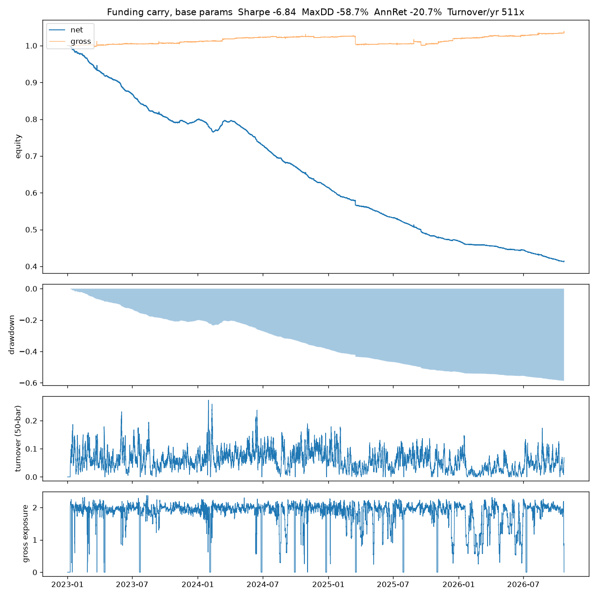
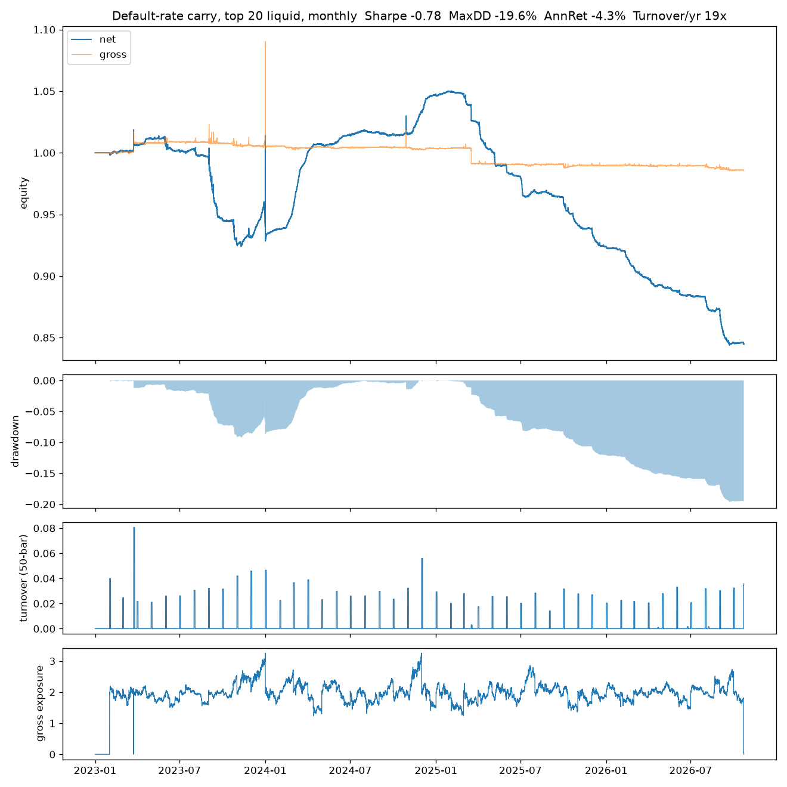

# Funding-rate carry on Binance perps

*The first of a planned set of notes on Binance perps. It tests the simplest delta-neutral carry book before anything is built on top of it, and it rules it out.*

**One line:** hedged funding carry (long spot / short perp) on Binance does not pay after costs in 2023–26: rotating into high-funding coins spends the income on turnover, holding liquid coins at the default rate loses −4.3% a year because below-default funding outweighs it, and the above-default spells that funded the trade in 2023–24 became about 20× rarer in 2025–26, with the most liquid coins hit hardest.

## Hypothesis
When leveraged longs crowd a perp, it trades above spot and longs pay shorts funding. A short perp hedged with long spot collects that funding without directional exposure. The edge is a premium for taking the other side of leverage demand, so it should exist only while that demand outweighs the capital willing to supply it.

Binance's funding has a floor-like default: an interest component of 0.01% per 8h (≈10.95% APR) that the rate sits at whenever the perp premium is small. So there are two distinct trades: collecting spikes **above** the default, and simply holding coins **at** the default.

## Data
- Binance USDT-M perps and Binance spot, hourly closes; funding from the fapi funding endpoint. 2023-01-01 to 2026-10-21.
- Universe: every USDT perp Binance has listed (655, including 133 delisted). 447 have a spot market and so can be hedged; 89 of those are delisted contracts (FTT, FTM, WAVES, MKR, OCEAN, AGIX, …), so the sample includes the casualties. Perp-only coins are excluded from every hedged study.
- Settlement intervals differ: at the end of the sample 509 coins settle every 4h, 134 every 8h, 12 every 1–2h, and 169 dropped to 1h at some point (Binance does this when funding is at its cap). All funding is put on fixed 8h UTC windows by summing the settlements inside each window (`qr/data/funding.py`); the default is 0.01% per 8h window at every interval (0.005% per 4h settlement, 0.00125% per 1h).
- Liquidity is point in time: trailing 30-day perp dollar volume on completed bars only.
- Binance keeps serving perp klines after a contract is delisted, with a frozen close. Perp prices are cut at each contract's delisting time (Binance's `deliveryDate`, 134 contracts), so a delisting force-closes the position in the backtester instead of leaving a frozen perp hedged against live spot.

## Method
Three studies, each answering one question:

1. **Persistence** (`scripts/funding_persistence.py`): a *spell* is a run of consecutive 8h windows with funding strictly above the default. Trade per spell: enter at the end of the first window above default (when it is known), earn from the next window, exit at the end of the first window back at or below default. Compared with a 28 bps round trip (4 legs × (4 bps fee + 3 bps slippage)). Funding only; basis PnL excluded.
2. **Default-rate carry** (`scripts/default_carry.py`): at each month start, the top 20 hedgeable coins by trailing volume, equal weight, +1/20 spot and −1/20 perp (2.0× gross), held through the month (drift not traded; delistings exit both legs). Full engine accounting: price and basis PnL, funding, 7 bps per leg. Funding is attributed to settlements at, above and below their interval's default.
3. **Funding by liquidity** (`scripts/funding_by_volume.py`): coins bucketed each window by trailing-volume rank (1–20, 21–50, 51–100, 101+); share of windows below the default, averaged per coin (coins with ≥ 30 windows in a cell), bootstrap CIs over coins.

## Results

### 1. Above-default spells are short and mostly do not pay for the trade
17,068 spells over 447 coins. Median length 2 windows (16h), mean 5.1, p90 11.

| After k windows (8h) | 2 | 3 (1d) | 9 (3d) | 21 (7d) | 42 (14d) | 153 (51d) |
| --- | --- | --- | --- | --- | --- | --- |
| Share of spells still above default | 57% | 40% | 14% | 5.6% | 1.1% | 0.0% |

A swap between coins costs ~28 bps and earns the carry difference for as long as it lasts; for a 2% APR gap the break-even is ~51 days. No spell population survives that long. Only 12.8% of spells earn their round trip; the mean spell nets −9.6 bps.

By the APR of the first window above default, mean funding net of the round trip (bps), bootstrap 95% CI:

| First-window APR | 2023–24 | 2025–26 |
| --- | --- | --- |
| 11–20% | −13.6 (−14.8, −12.2) | −23.8 (−24.6, −23.0) |
| 20–50% | −3.3 (−4.8, −1.6) | −21.2 (−23.1, −18.8) |
| 50–100% | **+10.5 (+4.7, +16.6)** | **−8.1 (−14.6, −0.4)** |
| > 100% | +25.1 (+2.4, +52.6) | +10.7 (−3.0, +27.0) |

The rule *enter above 50% APR, hold until back at default* was chosen from this table. It worked in 2023–24 and failed out of sample: the 50–100% bucket turned significantly negative in 2025–26, and > 100% kept its sign but is indistinguishable from zero (181 spells).

Spells also became rarer. The share of listed coin-windows above default fell about 20× for both settlement intervals (8h coins 13.9% → 0.7%, 4h coins 25.2% → 1.4%), while the number of listed hedgeable coins rose from 218 to 365. My first explanation, that 4h settlement shortened spells, is rejected: within each period 4h coins have slightly *longer* spells than 8h coins (2025–26 mean 2.5 vs 2.0 windows), and 8h coins, which never changed interval, collapsed just as much.

The rotation backtest shows the same thing in PnL. Book: top 10 by trailing 9-window funding among the top 40 by trailing volume, entry above 10% APR and exit below 3%, decisions at 8h window ends, 25% no-trade band, 8% drawdown kill switch, 2.0× gross, 7 bps per leg. It collected **+11.7% a year in funding and paid −35.8% a year in costs**: net −20.7% a year, Sharpe −6.8, max drawdown −58.7%, turnover 511× a year, almost all of it from selection changes (0.061 per bar from target changes against 0.058 total). All 25 parameter combinations are negative (Sharpe −18.2 to −0.3), and walk-forward out of sample returns −3.1% a year. The unhedged version (short perp only, perp-only coins allowed) roughly breaks even (−0.03% a year) with a −78% max drawdown and a −20% worst week (week ending 2025-10-12).



### 2. Holding liquid coins at the default does not pay either

| | 2023–24 | 2025–26 | Full |
| --- | --- | --- | --- |
| Ann. return (net) | +2.3% | −11.2% | −4.3% |
| Ann. vol | 7.3% | 2.0% | 5.5% |
| Sharpe | 0.35 | −5.99 | −0.78 |
| Max drawdown | −9.3% | −19.7% | −19.7% |
| Price / basis PnL / yr | +0.5% | −1.0% | −0.2% |
| Funding / yr | +3.5% | −9.7% | −2.8% |
| from settlements at default | +4.7% | +3.4% | +4.1% |
| from settlements above default | +7.7% | +0.3% | +4.2% |
| from settlements below default | −8.9% | −13.4% | −11.0% |
| Costs / yr | −1.4% | −1.2% | −1.3% |
| Turnover / yr | 20× | 17× | 19× |

Costs are about a twentieth of the rotation book's. The default component pays about 4% a year, not 10.95%, because only part of the time is spent at the default; the below-default settlements cost more than that in both periods.



### 3. Below-default funding is concentrated in the most liquid coins, increasingly so
Share of 8h windows below the default, per coin (≥ 30 windows in the cell), 95% CI:

| Volume rank | 2023–24 | 2025–26 |
| --- | --- | --- |
| 1–20 | 33.7% (29.9, 37.7) | 72.5% (68.0, 76.7) |
| 21–50 | 27.0% (24.4, 29.9) | 67.0% (63.5, 70.3) |
| 51–100 | 22.1% (20.3, 24.1) | 56.4% (53.7, 58.9) |
| 101+ | 18.1% (16.7, 19.6) | 37.5% (35.7, 39.4) |

Below-default funding rose in every bucket and is monotone in liquidity in both periods. On the odds scale, the top 20 coins' odds of below-default funding rose 5.2× against 2.7× for the tail; the ratio, 1.91 (bootstrap 95% CI 1.41–2.62 over coins), says the most liquid coins moved further. This is consistent with delta-neutral capital crowding the liquid perps: the same trade this note studies, run at scale, pushing the perp below spot so that shorts pay longs.

The same table is also consistent with **hedging that is not carry**: holders of spot BTC, ETH and SOL (treasury companies, funds, miners, ETF-adjacent desks) shorting the liquid perps to hedge their inventory, and directional shorts concentrating in the most liquid contracts in a weak market. Both put persistent short pressure on exactly the coins in the top bucket. Funding data alone cannot separate them from delta-neutral carry; that would need positioning data (open interest and its growth against funding) or the disclosed books of known delta-neutral issuers. So this note claims consistency with crowding, not proof of it.

## Validation
- **Out of sample:** the one rule chosen from the data (> 50% APR entry) was tested on the period split it was not tuned on and failed in 2025–26.
- **Survivorship:** the universe is every listed contract, including 89 hedgeable delisted coins; liquidity is ranked point in time. An earlier version that used today's top 40 by volume was discarded for selecting on survival.
- **Unit check:** default per settlement verified per interval (0.01% at 8h, 0.005% at 4h, 0.00125% at 1h) before attributing funding; funding attribution sums exactly to the engine's funding PnL.
- **Robustness:** the volume-bucket ordering is unchanged when coins that passed briefly through a bucket are dropped; bootstrap CIs resample coins, the independent unit.
- **Not done:** no deflated Sharpe, because there is no positive strategy to deflate; the persistence study is funding only (no basis PnL); 7 bps per leg is optimistic for small-cap spot.

## What broke
- **Rotation spends the carry on turnover.** Re-ranking every 8h swaps about one position every one to two settlements; each swap costs ~28 bps against a fraction of a basis point of extra carry per window, and the break-even (~51 days for a 2% APR gap) is longer than almost every spell.
- **The spell rule was in-sample.** The 50% threshold came from the same table that justified it, and the 2025–26 split rejected it.
- **The default is not free.** Holding liquid coins at the default earns ~4% a year from default settlements and gives back ~11% to below-default ones.
- **The opportunity shrank.** Above-default funding became ~20× rarer in 2025–26 across all settlement intervals, and below-default funding rose most in the coins with the most capacity.
- **My first explanation was wrong.** 4h settlement does not explain shorter spells; the collapse is market-wide.

- **Why nobody takes the other side.** Collecting below-default funding means long perp and **short spot**, and shorting spot means borrowing the coin on margin; the borrow rate, its limited and recallable supply, and the small size of the shortfall below default (a few bps per window on majors) mean the reverse trade does not pay either, so the imbalance persists. Borrow costs were not measured here; that is the next thing to check before calling it closed.

- **What predicts below-default funding at decision time.** Liquidity: a coin in the top 20 by trailing volume was below default in ~72% of 2025–26 windows against ~37% for the tail, and that rank is known in advance. It is only half an answer because it says *where*, not *when*: it is a cross-sectional base rate, not a timing signal, and avoiding the liquid coins leaves the illiquid tail, where 7 bps per leg is optimistic, spot depth caps size, and delistings live.

## Reproduce
```bash
python -m venv .venv && source .venv/bin/activate
pip install -e ".[dev]" && pytest                  # 32 tests
bash scripts/fetch_carry_data.sh 2023-01-01        # universe + funding + hourly perp/spot (~1–2 h)
# the first study run builds the funding and price matrices in data/processed/ (~15 min, once)
python scripts/funding_persistence.py              # study 1
python scripts/default_carry.py --n 20             # study 2 -> reports/default_carry/
python scripts/funding_by_volume.py --min-windows 30   # study 3
```
