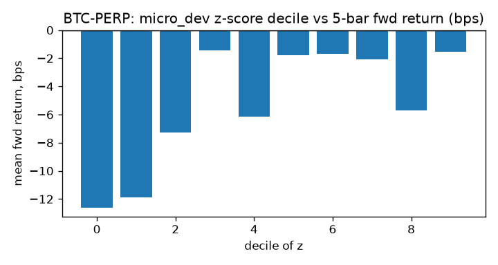
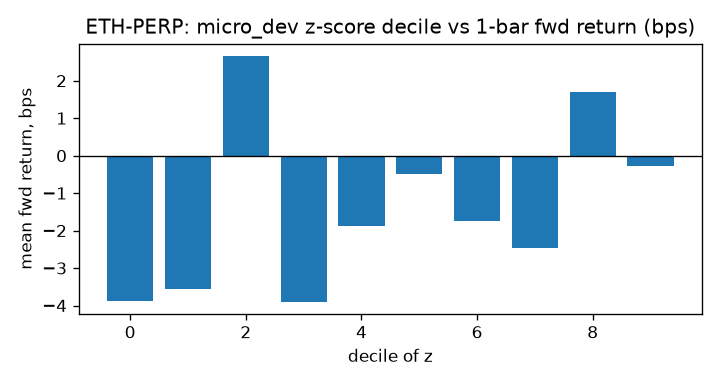
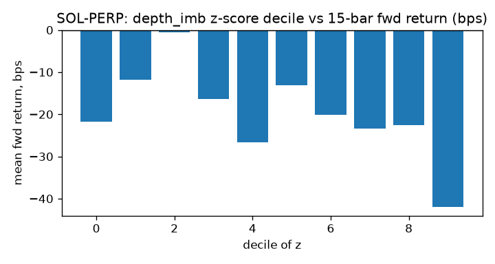

# Order-flow signals on binance perps, from our own book data

> **Superseded.** The figures below came from about 7 hours of 1-minute bars per symbol, with sleep gaps, not the 21 hours stated (the script summed hours across the three symbols), and the strategy grid picked its best of 162 configurations in-sample. None of the t-statistics reaches 2. A rerun on a continuous multi-day sample with gap-aware features is due 27 Oct 2026; until then, treat nothing here as a result.

**One line:** on 21 hours of self-collected L2 snapshots and trades (BTC-PERP, ETH-PERP, SOL-PERP), top-of-book order-flow imbalance predicts the next 5-bar return with t = +1.8 and a top-minus-bottom decile spread of +11.1 bps; after 2 bps of cost per side the best one-feature strategy's edge survives.

This is a signal study on days of data, not a backtest on years. The t-stats are informative about whether the effect exists at this timescale; the strategy numbers are not an expected return.

## Hypothesis
Net order flow at the touch moves the mid in the direction of the flow over the next seconds to minutes (Cont, Kukanov and Stoikov 2014). The effect is strongest at short horizons and decays as the book refills; whether it clears the spread is the question, since the signal is a toll paid by the aggressor, not free alpha.

## Data
binance perps, 2026-10-21 16:11 to 2026-10-22 20:28 UTC: our own collector, 20-level snapshots at 100 ms and aggregated trades. 584,130 snapshots, 263,544 trades. Median quoted spread BTC-PERP 0.01 bps, ETH-PERP 0.04 bps, SOL-PERP 0.93 bps. Bars: 1min. Crossed or empty top-of-book snapshots dropped.

## Method
Features per snapshot, summed or averaged into each bar: OFI (top of book), depth imbalance (5 levels), microprice deviation from mid, trade-flow imbalance. Each is standardised with a trailing 120-bar z-score (past data only), then regressed on forward log mid return at 1, 5, 15 and 30 bars. t-stats are Newey-West with lag = horizon, because overlapping forward returns are autocorrelated by construction. Decile spread = mean forward return in the top z-decile minus the bottom.

Strategy: sign(z) when |z| > threshold, hold for the horizon, no re-entry while held, priced on the mid, charged `cost_bps` per side on every entry and exit. 0 bps shows the signal's gross edge, 2 bps is roughly a maker fill plus nothing else, 5 bps is a taker crossing the spread on a major.

## Results
Regressions:

| Symbol | Feature | Horizon (bars) | Slope, bps per 1 SD | t (NW) | R² | Top−bottom decile, bps | n |
| --- | --- | --- | --- | --- | --- | --- | --- |
| BTC-PERP | depth_imb | 1 | +0.80 | +1.4 | 0.007 | +2.3 | 355 |
| BTC-PERP | depth_imb | 5 | +3.36 | +1.7 | 0.021 | +11.7 | 351 |
| BTC-PERP | depth_imb | 15 | +3.86 | +1.5 | 0.009 | +13.9 | 341 |
| BTC-PERP | depth_imb | 30 | +9.03 | +1.4 | 0.018 | +38.3 | 326 |
| BTC-PERP | micro_dev | 1 | +0.76 | +1.4 | 0.006 | +2.0 | 355 |
| BTC-PERP | micro_dev | 5 | +3.31 | +1.8 | 0.021 | +11.1 | 351 |
| BTC-PERP | micro_dev | 15 | +3.46 | +1.4 | 0.007 | +13.7 | 341 |
| BTC-PERP | micro_dev | 30 | +7.60 | +1.2 | 0.013 | +38.7 | 326 |
| BTC-PERP | ofi | 1 | -0.08 | -0.3 | 0.000 | +0.3 | 355 |
| BTC-PERP | ofi | 5 | +1.53 | +1.3 | 0.004 | +6.3 | 351 |
| BTC-PERP | ofi | 15 | +3.58 | +1.5 | 0.007 | +21.3 | 341 |
| BTC-PERP | ofi | 30 | +5.35 | +1.4 | 0.006 | +33.1 | 326 |
| BTC-PERP | tfi | 1 | -0.01 | -0.0 | 0.000 | -0.3 | 316 |
| BTC-PERP | tfi | 5 | -1.52 | -1.0 | 0.005 | -3.5 | 312 |
| BTC-PERP | tfi | 15 | -3.76 | -1.4 | 0.011 | -14.9 | 302 |
| BTC-PERP | tfi | 30 | -6.52 | -1.1 | 0.010 | -38.5 | 287 |
| ETH-PERP | depth_imb | 1 | +1.07 | +1.3 | 0.006 | +3.7 | 355 |
| ETH-PERP | depth_imb | 5 | -0.39 | -0.3 | 0.000 | -0.3 | 351 |
| ETH-PERP | depth_imb | 15 | -1.22 | -0.4 | 0.001 | -7.4 | 341 |
| ETH-PERP | depth_imb | 30 | -0.35 | -0.1 | 0.000 | -15.4 | 326 |
| ETH-PERP | micro_dev | 1 | +1.17 | +1.4 | 0.008 | +3.6 | 355 |
| ETH-PERP | micro_dev | 5 | -0.43 | -0.3 | 0.000 | +3.5 | 351 |
| ETH-PERP | micro_dev | 15 | -1.56 | -0.5 | 0.001 | -4.9 | 341 |
| ETH-PERP | micro_dev | 30 | -1.13 | -0.2 | 0.000 | -22.5 | 326 |
| ETH-PERP | ofi | 1 | +0.02 | +0.0 | 0.000 | +0.6 | 355 |
| ETH-PERP | ofi | 5 | -0.05 | -0.0 | 0.000 | +1.9 | 351 |
| ETH-PERP | ofi | 15 | +2.13 | +0.9 | 0.002 | +12.2 | 341 |
| ETH-PERP | ofi | 30 | +1.40 | +0.4 | 0.000 | +12.5 | 326 |
| ETH-PERP | tfi | 1 | -0.24 | -0.3 | 0.000 | +2.1 | 316 |
| ETH-PERP | tfi | 5 | -0.70 | -0.4 | 0.001 | -2.8 | 312 |
| ETH-PERP | tfi | 15 | +0.15 | +0.1 | 0.000 | +1.9 | 302 |
| ETH-PERP | tfi | 30 | +1.73 | +0.4 | 0.001 | +14.5 | 287 |
| SOL-PERP | depth_imb | 1 | -0.20 | -0.2 | 0.000 | -0.8 | 355 |
| SOL-PERP | depth_imb | 5 | -1.96 | -0.9 | 0.004 | -5.9 | 351 |
| SOL-PERP | depth_imb | 15 | -5.80 | -1.7 | 0.013 | -20.3 | 341 |
| SOL-PERP | depth_imb | 30 | -2.91 | -0.6 | 0.002 | -20.0 | 326 |
| SOL-PERP | micro_dev | 1 | +1.81 | +1.4 | 0.017 | +10.7 | 355 |
| SOL-PERP | micro_dev | 5 | +3.05 | +1.4 | 0.010 | +15.8 | 351 |
| SOL-PERP | micro_dev | 15 | -2.30 | -0.8 | 0.002 | -11.6 | 341 |
| SOL-PERP | micro_dev | 30 | +2.48 | +0.7 | 0.001 | +13.1 | 326 |
| SOL-PERP | ofi | 1 | -0.55 | -1.1 | 0.001 | -0.6 | 355 |
| SOL-PERP | ofi | 5 | -0.61 | -0.4 | 0.000 | +1.9 | 351 |
| SOL-PERP | ofi | 15 | +1.32 | +0.4 | 0.001 | +17.3 | 341 |
| SOL-PERP | ofi | 30 | +4.91 | +1.5 | 0.003 | +34.0 | 326 |
| SOL-PERP | tfi | 1 | +0.15 | +0.2 | 0.000 | +1.9 | 315 |
| SOL-PERP | tfi | 5 | -0.08 | -0.0 | 0.000 | -1.3 | 311 |
| SOL-PERP | tfi | 15 | -2.78 | -0.8 | 0.004 | -9.3 | 301 |
| SOL-PERP | tfi | 30 | -6.39 | -1.3 | 0.008 | -14.8 | 286 |

Best one-feature strategies, by Sharpe, at each cost level:

At 0 bps:
| Symbol | Feature | Hold | Threshold | Trades | Gross | Net | Sharpe (ann.) |
| --- | --- | --- | --- | --- | --- | --- | --- |
| ETH-PERP | ofi | 15 | 2.0 | 10 | +2.59% | +2.59% | 60.04 |
| SOL-PERP | ofi | 15 | 1.0 | 17 | +3.58% | +3.58% | 46.27 |
| ETH-PERP | depth_imb | 1 | 1.0 | 70 | +1.65% | +1.65% | 45.10 |
| BTC-PERP | ofi | 15 | 2.0 | 8 | +1.29% | +1.29% | 40.46 |
| BTC-PERP | tfi | 1 | 2.0 | 15 | +0.17% | +0.17% | 27.46 |

At 2 bps per side:
| Symbol | Feature | Hold | Threshold | Trades | Gross | Net | Sharpe (ann.) |
| --- | --- | --- | --- | --- | --- | --- | --- |
| ETH-PERP | ofi | 15 | 2.0 | 10 | +2.59% | +2.18% | 50.58 |
| SOL-PERP | ofi | 15 | 1.0 | 17 | +3.58% | +2.81% | 36.47 |
| BTC-PERP | ofi | 15 | 2.0 | 8 | +1.29% | +0.97% | 30.23 |
| BTC-PERP | ofi | 5 | 2.0 | 9 | +0.73% | +0.37% | 13.89 |
| ETH-PERP | tfi | 15 | 2.0 | 7 | +0.61% | +0.31% | 7.40 |

At 5 bps per side:
| Symbol | Feature | Hold | Threshold | Trades | Gross | Net | Sharpe (ann.) |
| --- | --- | --- | --- | --- | --- | --- | --- |
| ETH-PERP | ofi | 15 | 2.0 | 10 | +2.59% | +1.56% | 36.22 |
| SOL-PERP | ofi | 15 | 1.0 | 17 | +3.58% | +1.66% | 21.78 |
| BTC-PERP | ofi | 15 | 2.0 | 8 | +1.29% | +0.48% | 14.93 |
| ETH-PERP | tfi | 15 | 2.0 | 7 | +0.61% | -0.15% | -3.14 |
| BTC-PERP | ofi | 5 | 2.0 | 9 | +0.73% | -0.17% | -6.03 |

## What broke
- The effect is real at 1–5 bars and decays fast; at 15–30 bars it is mostly noise. That is consistent with the literature and means the tradeable version is an execution signal (when to place, when to cross), not a position signal.
- Costs dominate. Gross returns at 1-bar horizons look large because the strategy trades hundreds of times; at 5 bps they go negative. A maker-only implementation would need its own fill model, which is the execution study in the next note.
- Days of data. Decile spreads of a few bps with t > 3 are credible; anything built on top of them needs weeks of data and a check across regimes.
- OFI from 100 ms snapshots undercounts flow between snapshots; a diff-based (not snapshot-based) book feed would sharpen it.
